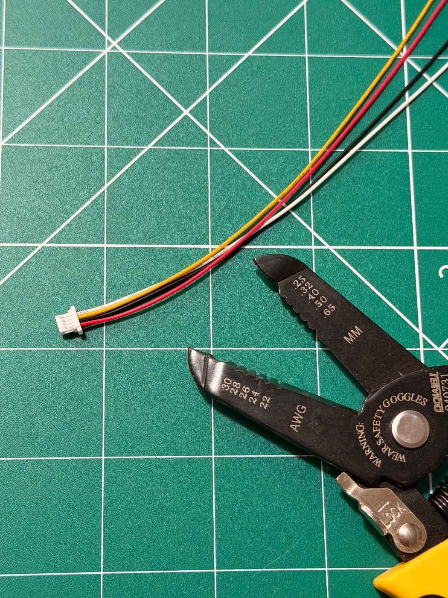
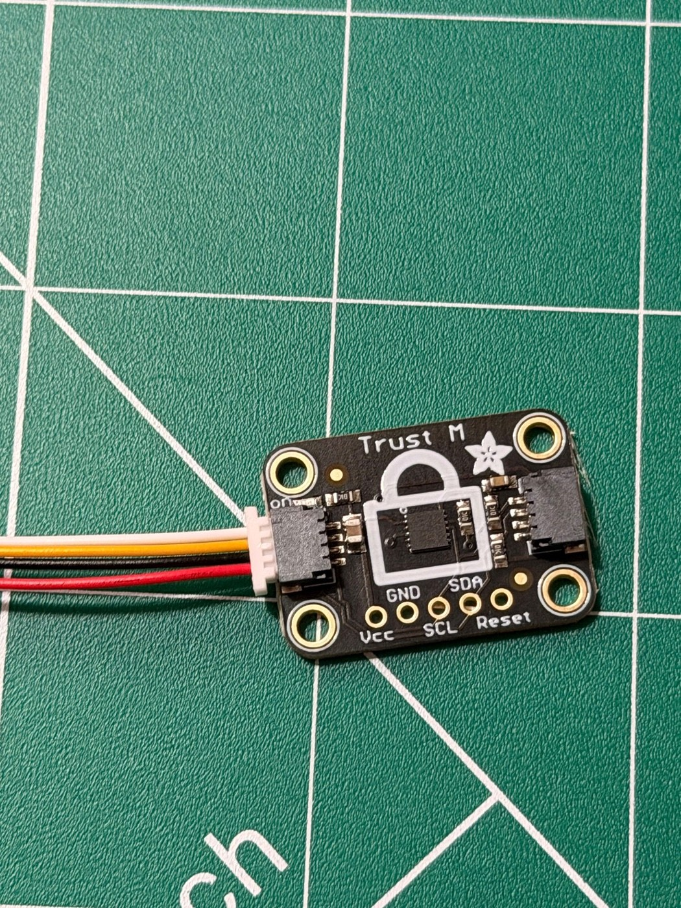

# Assembly

Photos in order. Draft. This becomes a one-page guide later.

## 1. Cable and tools

You need a 4-wire cable with a small plug on one end, plus wire cutters and strippers.

## 2. Plug the cable into the Trust M board

Wire order across the plug, top to bottom in the photo: white, yellow, black, red.
<!-- TODO: confirm which wire goes to which pin (Vcc, GND, SCL, SDA) -->

