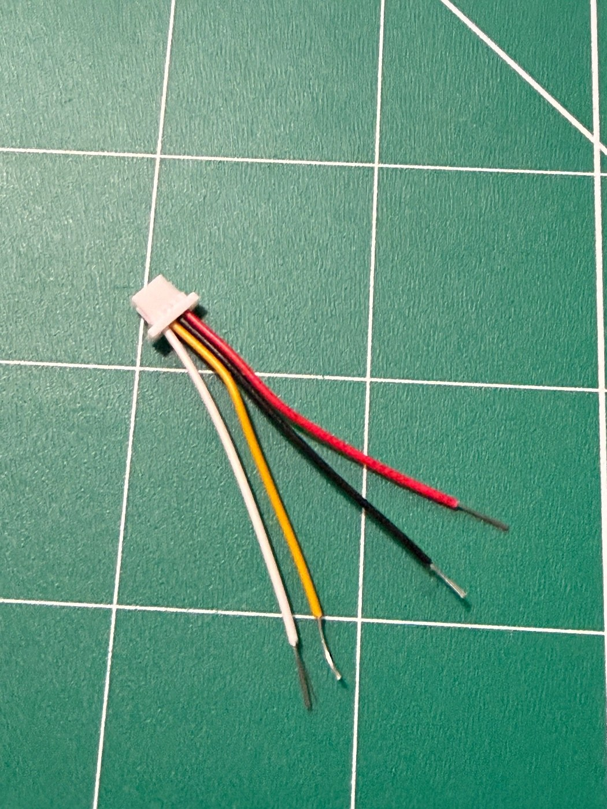
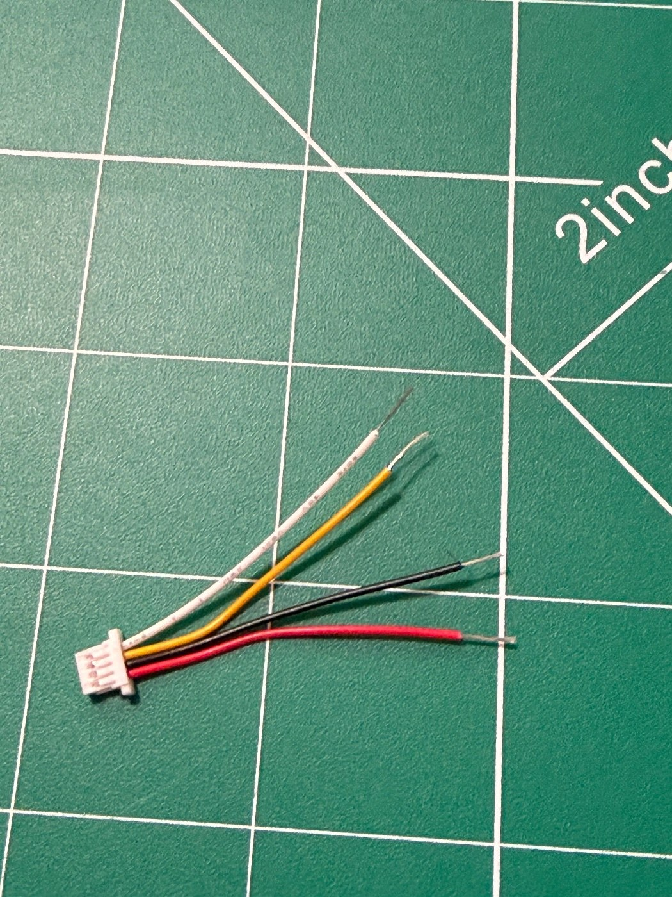
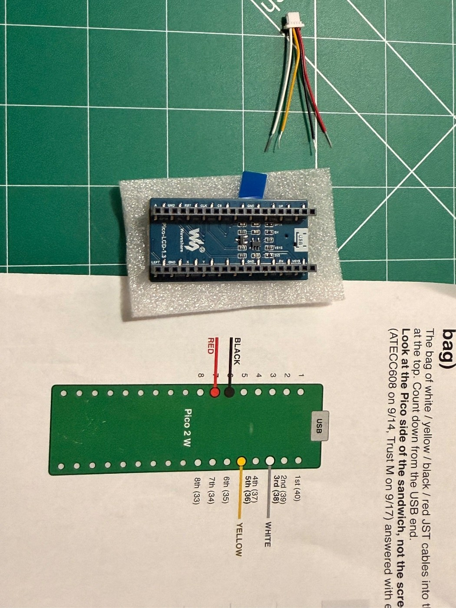

# Assembly

Photos in order. Draft. This becomes a one-page guide later.

## 1. Cable and tools

You need a 4-wire cable with a small plug on one end, plus wire cutters and strippers.

## 2. Plug the cable into the Trust M board

Wire order across the plug, top to bottom in the photo: white, yellow, black, red.

## 3. Cut and strip the wires

Cut the cable short, leaving the plug end. Strip the tip of each of the 4 wires.
<!-- TODO: how long to cut, how much to strip -->

## 4. Lay out the screen board and the wiring guide

Take out the LCD board. Turn it face down so the header pins point at you, USB at the top.

Solder each wire to the Pico pin shown. Count pins from the USB end.

| Wire | Signal | Pico pin |
|---|---|---|
| White | GND | 3rd on the USB-side row (pin 38) |
| Yellow | 3.3 V | 5th on that row (pin 36) |
| Black | SDA | 6th on the other row (pin 6, GP4) |
| Red | SCL | 7th on the other row (pin 7, GP5) |

<!-- TODO: redraw the wiring guide as a clean diagram for the one-pager -->

